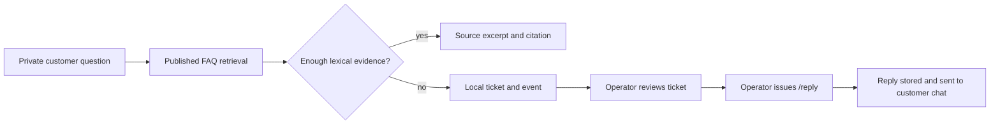

# AI Telegram Support Bot


[](https://github.com/jezannn16/ai-telegram-support-bot/actions/workflows/ci.yml)
[](https://www.python.org/)

**A local FAQ and support-ticket workflow with an optional Telegram front end.** Published Markdown, text, or text-based PDF documents provide source excerpts when they match a question. When evidence is weak, the bot opens a ticket for an operator. The retrieval is lexical and deterministic; despite the project name, it does not call an AI model.

| | |
|---|---|
| **Local mode** | FAQ import/search, ticket handling, evaluation, SQLite backup |
| **Telegram** | Optional polling for customer and operator commands |
| **Reply delivery** | An operator's `/reply` sends a Telegram message to that ticket's customer |
| **AI/LLM** | Not implemented |

## Contents

- [Quick start](#quick-start)
- [Telegram setup](#telegram-setup)
- [Support flow](#support-flow)
- [Operator workflow](#operator-workflow)
- [Privacy and limits](#privacy-and-limits)
- [Development](#development)

## Quick start

Python 3.11 or newer is required. The install includes `pypdf` for text-based PDF import:

```sh
python3 -m venv .venv
.venv/bin/python -m pip install -e .
```

Load the synthetic FAQ into a temporary database, ask a supported question, then ask one that needs a human:

```sh
.venv/bin/python app.py --db /tmp/support-demo.sqlite3 faq-add 'Returns policy' fixtures/faq.md --publish
.venv/bin/python app.py --db /tmp/support-demo.sqlite3 ask customer-1 'How long do I have to return an unopened product?'
.venv/bin/python app.py --db /tmp/support-demo.sqlite3 ask customer-1 'Can you guarantee delivery tomorrow?'
.venv/bin/python app.py --db /tmp/support-demo.sqlite3 ticket customer-1 1
```

The FAQ response includes its source and paragraph/page citation. The unsupported question creates a local ticket. CLI operator commands need `SUPPORT_OPERATORS` set to the operator IDs configured for the local workflow.

## Telegram setup

The bot needs a BotFather token in `TELEGRAM_BOT_TOKEN`. Set `SUPPORT_OPERATORS` to a comma-separated list of numeric Telegram user IDs authorized to manage tickets. Use a dedicated test bot and a fresh local database when trying the Telegram workflow. Do not put the token in source, chat, tickets, or GitHub Actions logs.

```sh
export TELEGRAM_BOT_TOKEN='set-this-in-your-local-shell'
export SUPPORT_OPERATORS='your-numeric-telegram-user-id'
.venv/bin/python telegram_bot.py --db /tmp/support-telegram-test.sqlite3
```

Starting polling connects to Telegram and accepted private messages receive a bot response. You can validate the token without reading updates or sending a message:

```sh
.venv/bin/python check_telegram_token.py
```

This calls only Bot API [`getMe`](https://core.telegram.org/bots/api#getme) and prints the bot username. It does not exercise polling or delivery. For a real ticket reply, an operator must run `/reply`; that command sends its text to the customer in Telegram. Use only synthetic customer data while validating that behavior.

## Support flow



The lexical matcher looks for term overlap in published paragraphs or PDF pages. It excludes draft and retired documents. It does not interpret policy meaning, generate an answer, assess truth, or invoke an LLM.

## Operator workflow

With a local CLI database, set the operator ID and inspect the synthetic ticket:

```sh
SUPPORT_OPERATORS=900 .venv/bin/python app.py --db /tmp/support-demo.sqlite3 tickets 900 --operator
SUPPORT_OPERATORS=900 .venv/bin/python app.py --db /tmp/support-demo.sqlite3 ticket 900 1 --operator
SUPPORT_OPERATORS=900 .venv/bin/python app.py --db /tmp/support-demo.sqlite3 assign 900 1 900
SUPPORT_OPERATORS=900 .venv/bin/python app.py --db /tmp/support-demo.sqlite3 reply 900 1 'An operator reviewed this request.'
```

The CLI stores a reply locally and does not notify the customer. Telegram `/reply` has different, explicit delivery behavior and sends the response to the customer after the outbox records it. `/export` writes the caller's tickets and messages to the chat; `/delete_me CONFIRM` removes that caller's local history.

## Privacy and limits

- The SQLite database stores customer messages and operator activity. Protect the database and any backups as support data.
- Telegram accepts private chats only. Customer ticket queries are scoped by Telegram user ID; operator commands check the current `SUPPORT_OPERATORS` allowlist.
- Telegram requests are limited to 10 per user in a persisted 60-second window; oversized messages are rejected before ticket processing.
- Use `purge-closed --older-than-days N --confirm` to enforce a local retention window for closed tickets; open tickets are retained. `export USER FILE` includes tickets, messages, event history, and conversation data. User deletion also clears queued chat responses and legacy update payloads for that user.
- Bot polling itself sends replies for accepted messages. Do not start it with a production token when testing synthetic cases.
- The durable outbox uses at-most-once delivery. Inspect it with `outbox OPERATOR_ID --operator`; `retry-delivery OPERATOR_ID ID --operator --confirm` queues only a definite `failed` item for another attempt. An `uncertain` item requires manual inspection because delivery may already have occurred. Attempt counts are persisted.
- PDF parsing extracts embedded text only. Scanned-document OCR, automated retention, restore drills, rate limiting, webhook mode, hosted deployment, and LLM/RAG are not implemented.
- The evaluation uses synthetic cases and measures behavior/citation structure. It is not a benchmark of general support accuracy.

## Development

```sh
.venv/bin/python -m pip install -e '.[dev]'
.venv/bin/python -m unittest discover -v
.venv/bin/python app.py --db /tmp/support-eval.sqlite3 eval --report /tmp/support-evaluation.json
.venv/bin/ruff check .
```

CI runs the tests, synthetic evaluation command, and Ruff on Python 3.11 and 3.13 without Telegram credentials. A separate opt-in `getMe` probe checks a real token without sending messages or consuming updates.

See [docs/demo.md](docs/demo.md) for the synthetic FAQ/operator walkthrough and [docs/operator-runbook.md](docs/operator-runbook.md) for delivery recovery and data-handling steps. Use `app.py --help` and `telegram_bot.py --help` for command options.
