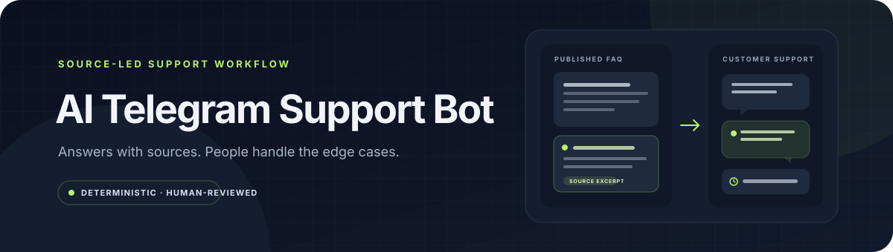
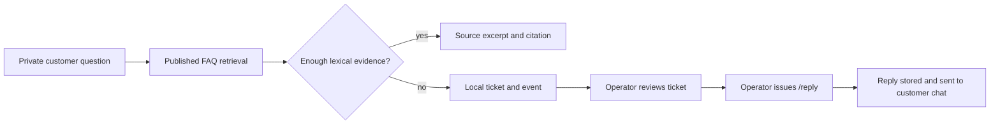

# AI Telegram Support Bot



[](https://github.com/jezannn16/ai-telegram-support-bot/actions/workflows/ci.yml)
[](https://www.python.org/)

**A local FAQ and support-ticket workflow with an optional Telegram front end.** Published Markdown, text, or text-based PDF documents provide source excerpts when they match a question. When evidence is weak, the bot opens a ticket for an operator. Retrieval is lexical and deterministic. An opt-in LLM adapter can phrase an answer from retrieved excerpts; it is off by default.

| | |
|---|---|
| **Local mode** | FAQ import/search, ticket handling, evaluation, SQLite backup |
| **Telegram** | Optional polling for customer and operator commands |
| **Reply delivery** | An operator's `/reply` sends a Telegram message to that ticket's customer |
| **AI/LLM** | Optional, explicit OpenAI API integration; deterministic mode remains the default |

## Contents

- [Quick start](#quick-start)
- [Telegram setup](#telegram-setup)
- [Support flow](#support-flow)
- [Operator workflow](#operator-workflow)
- [Privacy and limits](#privacy-and-limits)
- [Development](#development)

## Quick start

Python 3.11 or newer is required. Check that `python3 --version` reports a supported version; if your system's `python3` is older, use the explicit path to an installed Python 3.11+ executable in the venv command. The install includes `pypdf` for text-based PDF import:

```sh
python3 -m venv .venv
.venv/bin/python -m pip install --upgrade pip
.venv/bin/python -m pip install -e .
```

Load the synthetic FAQ into a temporary database, ask a supported question, then ask one that needs a human:

```sh
.venv/bin/python app.py --db /tmp/support-demo.sqlite3 faq-add 'Returns policy' fixtures/faq.md --publish
.venv/bin/python app.py --db /tmp/support-demo.sqlite3 ask customer-1 'How long do I have to return an unopened product?'
.venv/bin/python app.py --db /tmp/support-demo.sqlite3 ask customer-1 'Can you guarantee delivery tomorrow?'
.venv/bin/python app.py --db /tmp/support-demo.sqlite3 ticket customer-1 1
```

The FAQ response includes its source and paragraph/page citation. The unsupported question creates a local ticket. CLI operator commands need `SUPPORT_OPERATORS` set to the operator IDs configured for the local workflow.

## Telegram setup

The bot needs a BotFather token in `TELEGRAM_BOT_TOKEN`. Set `SUPPORT_OPERATORS` to a comma-separated list of numeric Telegram user IDs authorized to manage tickets. Use a dedicated test bot and a fresh local database when trying the Telegram workflow. Do not put the token in source, chat, tickets, or GitHub Actions logs.

```sh
export TELEGRAM_BOT_TOKEN='set-this-in-your-local-shell'
export SUPPORT_OPERATORS='your-numeric-telegram-user-id'
.venv/bin/python telegram_bot.py --db /tmp/support-telegram-test.sqlite3
```

Starting polling connects to Telegram and accepted private messages receive a bot response. You can validate the token without reading updates or sending a message:

```sh
.venv/bin/python check_telegram_token.py
```

This calls only Bot API [`getMe`](https://core.telegram.org/bots/api#getme) and prints the bot username. It does not exercise polling or delivery. For a real ticket reply, an operator must run `/reply`; that command sends its text to the customer in Telegram. Use only synthetic customer data while validating that behavior.

## Support flow



The lexical matcher looks for term overlap in published paragraphs or PDF pages. It excludes draft and retired documents. Retrieval remains lexical even when the optional LLM adapter is enabled. Operator ticket views include a bounded extractive handoff summary of the ticket dialogue and source excerpts; customers never see this internal summary.

### Optional LLM answer adapter

LLM use is disabled unless `SUPPORT_LLM_ENABLED=1` **and** `OPENAI_API_KEY` are both present. With either missing, CLI and Telegram retain the existing deterministic evidence-excerpt flow and make no API request. When enabled, the app sends only the current customer question and up to five excerpts from published documents selected by local retrieval; it does not send ticket history, other customers' data, or tools. Treat this as disclosure to an external API provider and review its current data controls before enabling it.

The model must return the validated JSON structure. Citations are IDs that the server resolves back to retrieved sources; invented IDs, empty citations, malformed responses, or transport errors are never shown as generated answers. Transport/schema failures fall back to the deterministic source excerpts. A model refusal creates an operator handoff ticket with retrieved source context. Prompt-injection attempts in questions and documents are marked as untrusted input, but no prompt can guarantee that a model is immune to injection or unsupported claims; check answers against the displayed citations.

The adapter uses OpenAI's Chat Completions JSON Schema response format, a 20-second request timeout, no tools, and a fixed HTTPS API host. Its default model is `gpt-4o-mini`; `SUPPORT_LLM_MODEL` can select a compatible model. **It may incur API charges when enabled.** No paid request was used for development or tests. See the official [Structured Outputs guide](https://developers.openai.com/api/docs/guides/structured-outputs) and [Chat Completions API reference](https://developers.openai.com/api/reference/resources/chat).

```sh
export SUPPORT_LLM_ENABLED=1
export OPENAI_API_KEY='set-this-in-your-local-shell'
# Optional model override:
export SUPPORT_LLM_MODEL='gpt-4o-mini'
.venv/bin/python app.py --db /tmp/support-demo.sqlite3 ask customer-1 'How long do I have to return an unopened product?'
```

## Operator workflow

With a local CLI database, set the operator ID and inspect the synthetic ticket:

```sh
SUPPORT_OPERATORS=900 .venv/bin/python app.py --db /tmp/support-demo.sqlite3 tickets 900 --operator
SUPPORT_OPERATORS=900 .venv/bin/python app.py --db /tmp/support-demo.sqlite3 ticket 900 1 --operator
SUPPORT_OPERATORS=900 .venv/bin/python app.py --db /tmp/support-demo.sqlite3 assign 900 1 900
SUPPORT_OPERATORS=900 .venv/bin/python app.py --db /tmp/support-demo.sqlite3 reply 900 1 'An operator reviewed this request.'
```

The CLI stores a reply locally and does not notify the customer. Telegram `/reply` has different, explicit delivery behavior and sends the response to the customer after the outbox records it. `/export` writes the caller's tickets and messages to the chat; `/delete_me CONFIRM` removes that caller's local history.

## Privacy and limits

- The SQLite database stores customer messages and operator activity. Protect the database and any backups as support data.
- Telegram accepts private chats only. Customer ticket queries are scoped by Telegram user ID; operator commands check the current `SUPPORT_OPERATORS` allowlist.
- Telegram requests are limited to 10 per user in a persisted 60-second window; oversized messages are rejected before ticket processing.
- Use `purge-closed --older-than-days N --confirm` to enforce a local retention window for closed tickets; open tickets are retained. `export USER FILE` includes tickets, messages, event history, and conversation data. User deletion also clears queued chat responses and legacy update payloads for that user.
- Bot polling itself sends replies for accepted messages. Do not start it with a production token when testing synthetic cases.
- The durable outbox uses at-most-once delivery. Inspect it with `outbox OPERATOR_ID --operator`; `retry-delivery OPERATOR_ID ID --operator --confirm` queues only a definite `failed` item for another attempt. An `uncertain` item requires manual inspection because delivery may already have occurred. Attempt counts are persisted.
- Create a verified, owner-only SQLite backup at a new path with `python3 app.py --db support.sqlite3 health --backup /safe/path/support-backup-2026-10-30.sqlite3`. Backup creation refuses existing paths and symlinks, so choose a fresh filename for each copy. Restore only a Support Bot database: stop the bot and all other users, then run `python3 app.py --db support.sqlite3 restore /safe/path/support-backup-2026-10-30.sqlite3 --confirm`. Restore validates SQLite integrity, foreign keys, migration version, and required columns; it refuses symlinked database/sidecar paths and unrelated destination schemas. Existing databases are restored through SQLite's backup API so their WAL files are handled by SQLite rather than deleted ahead of replacement. Keep backups protected as customer data.
- PDF parsing extracts embedded text only. Scanned-document OCR, scheduled retention/backup drills, webhook mode, and hosted deployment are not implemented. The CLI can create and restore a verified SQLite backup; restore must be run while the bot and other database users are stopped. If the target database changes during restore preparation, the operation aborts and leaves that change intact.
- The lexical evaluation has 37 hand-authored synthetic cases, including a money-back/refund paraphrase and a hard negative whose only overlap is generic customer/support wording. The retriever normalizes that English paraphrase and drops common English/Russian customer-support terms; a separate regression checks Russian exact-term retrieval and generic-overlap rejection. It still permits a one-term focused lookup. Hit rate is conditional on 14 cases with expected sources; recall divides matching retrieved titles by 18 expected titles; citation precision includes all returned citations. The constructed set routes 37/37 as expected, but the examples are handcrafted around the narrow rules and are diagnostic, not an independent benchmark. Unsupported-claim rate is null because no generated prose or human claim annotations exist. No general accuracy or model-quality claim follows from these results.
- `rag-eval` runs 11 in-process fake-transport contract cases: valid/invalid and duplicate citations, structured/native refusal, malformed output, injection in both question and retrieved text, conflicting sources, provider failure, and empty retrieval. The report identifies the fake provider, zero network calls, and `model_quality_evaluated=false`; injection cases check that text is framed as untrusted data but do not establish that a model resists it. No paid API is used.

## Development

```sh
.venv/bin/python -m pip install -e '.[dev]'
.venv/bin/python -m unittest discover -v
.venv/bin/python app.py --db /tmp/support-eval.sqlite3 eval --report /tmp/support-evaluation.json
.venv/bin/python app.py --db /tmp/support-eval.sqlite3 rag-eval --report /tmp/rag-contract-report.json
.venv/bin/ruff check .
```

CI runs the tests, synthetic retrieval evaluation, fake-transport RAG contract evaluation, and Ruff on Python 3.11 and 3.13 without Telegram or LLM credentials. A separate opt-in `getMe` probe checks a real Telegram token without sending messages or consuming updates.

See [docs/demo.md](docs/demo.md) for the synthetic FAQ/operator walkthrough and [docs/operator-runbook.md](docs/operator-runbook.md) for delivery recovery and data-handling steps. Use `app.py --help` and `telegram_bot.py --help` for command options.
